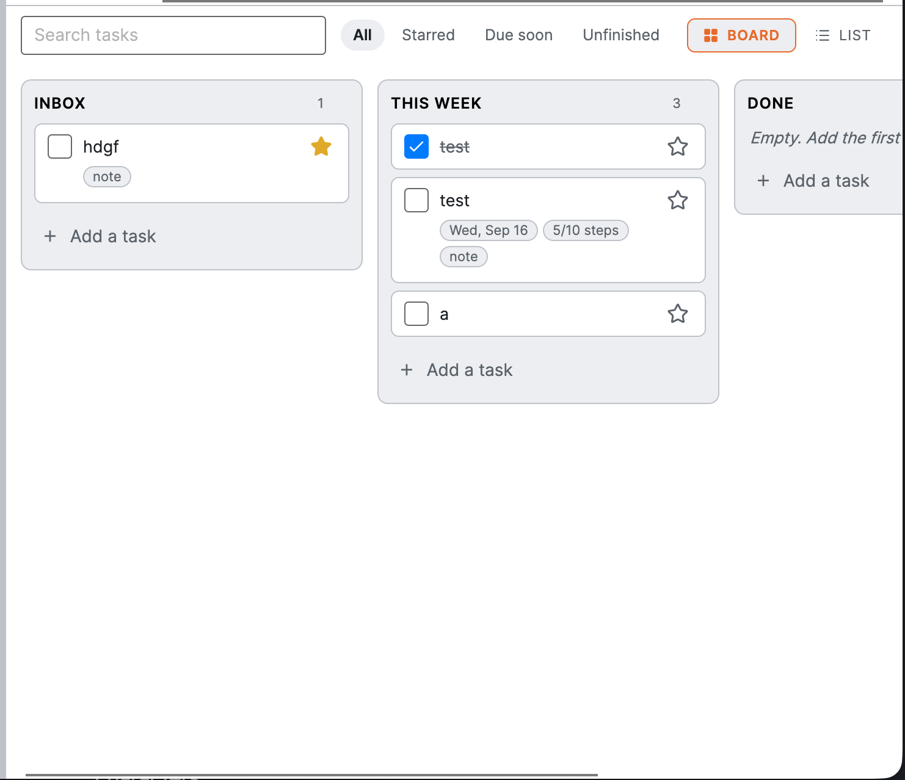
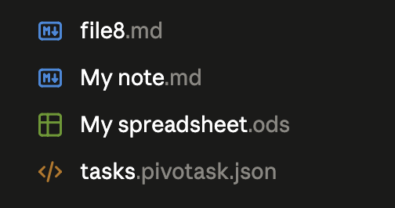

- [x] Puffinote: UI bug where clicking a tab in the tab bar at the top double highlights content in the sidebar. The sidebar should always simply match the highlight of the single file that corresponds to the active tab on the top, if there is a tab open.
- [x] Cellestra: active tab should have a colored underline underneath it in addition to the bold
- [x] Cellestra: auto resize columns to fit contents while in a table
- [x] Cellestra: header column format should also copy when adding new line after
- [x] Cellestra: editing text in a column that has word wrapped should word wrap as well (textbox should contain the contents and the cursor behavior should be expected)
- [x] Cellestra: double clicking the title bar to expand the column should widen it to the widest non-word-wrapped column, instead of all column lengths
- [x] Cellestra: while editing a value with white text in the light theme (table header) the text remains white, it should be black so you can see it against the background
- [x] Cellestra: pre-fill previous commands done in the current session at the top of the command bar so you can quickly do them again
- [x] Cellestra: change "?" keyboard shortcut to cmd+? since I do actually type "?" into cells from the main navigation view
- [x] Cellestra: if text is autocompleted while entering, if I use a different case than the autocomplete does it should stop autocompleting and type the correct capitalization on the letter
- [x] Cellestra: saving the document should append "- Saved" to the top title bar for a brief period
- [x] Cellestra: shift+return to enter newline in editing textbox
- [x] Cellestra: when editing cell, keep the current behavior of the cell remaining on screen, but ensure it continues being edited without the odd delay it has currently for new characters
- [x] Cellestra: when scrolling and a table's contents are on screen, visually show table's column titles in the top column headers (and remember to also do the opposite, if scrolling past the table end it should revert back to not include the titles at the top headers)
- [x] Typage: bug fix for unexpected behavior that adds extra newlines unexpectedly
- [x] Plaintain: Create a new plaintext editor (use the plan file)
- [x] Pivotask: Create a new todos editor (use the plan file)

- [x] Across all apps, add a settings menu to be able to configure the options present in the configuration file.
    - [x] Cellestra
    - [x] Puffinote
    - [x] Typage
    - [x] Plaintain
    - [x] Pivotask

- [x] Across all apps, Center-align the document name in the title bar
    - [x] Cellestra
    - [x] Puffinote
    - [x] Typage
    - [x] Plaintain
    - [x] Pivotask

    One shared control, `shared/Puffinote.Components/Shell/DocumentTitleBar.cs`. There was nothing to
    align before this: every app left its title to the native title bar, which macOS centres and the
    other platforms left-align, and which showed whatever `Window.Title` said — suffixes and all. The
    bar is the app's own, so it can show the document's name alone, centred, with the "edited" dot and
    Cellestra's transient "Saved" badge. `DocumentTitleBar.Extend` merges it with the window on macOS
    (extending the client area keeps the traffic lights and drops only the system's title text), which
    is Cellestra PRD §6.1's "unified with the window". `Window.Title` is unchanged — it is what the
    Window menu and app switcher show. **Not verified on a real Mac**: the container is headless, so
    the extended-client-area path (traffic-light inset, drag, double-click zoom) is reasoned about, not
    seen. Windows and Linux keep their native title bar with this one below it; taking those over means
    owning the caption buttons too, which is its own piece of work.

- [x] Across all apps, the custom title bar should carry the OS title bar's click behaviours — double-click
  to maximise, double-click again to return to the previous size and position, click and drag to move the
  window.
    - [x] Cellestra
    - [x] Puffinote
    - [x] Typage
    - [x] Plaintain
    - [x] Pivotask

    All five mount the one `DocumentTitleBar`, so this is one control's job. It already had a drag/zoom
    handler and **none of it ever ran**: the handler asked for `VisualRoot as Window`, and as of Avalonia 12
    a window's visual root is the host that draws its frame, with the `Window` beneath it — so the cast
    yielded null on every press and the bar silently did nothing. `TopLevel.GetTopLevel` is the supported
    way to ask. On top of that fix: the move is now armed on the press and only begun once the pointer
    travels 4px, because every platform's window move is a modal loop that owns the mouse until the button
    comes up — starting it on the press would have swallowed the second click of every double-click. A
    window that can't be resized doesn't zoom (its zoom button is disabled everywhere), full screen is left
    to the window manager, and a maximised window being dragged is left alone too: restoring it under the
    cursor, snapping to screen edges and honouring modifiers are all the window manager's own gestures, and
    it performs them for free once `BeginMoveDrag` hands over. Covered by `DocumentTitleBarGestureTests`.
    **Still not verified on a real Mac** for the same reason as the item above — the container is headless.
    Not done: right-click for the system window menu (Avalonia exposes no API for it), and macOS's
    "double-click a window's title bar to Minimize" preference, which we can't read without new interop —
    both would be worth a look on a Mac.

- [x] If not present, implement zooming in/out across all apps (puffinote and typage)(cmd + zooms in, cmd - zooms out)
    - [x] Cellestra
    - [x] Puffinote
    - [x] Typage
    - [x] Plaintain
    - [x] Pivotask
    - Zoom In / Zoom Out / Actual Size are defined once in `Puffinote.Components` (`ZoomCommands` over the
      shared `ZoomScale` ladder, 50%–400%) and spliced into each editor's own catalog, so all five apps carry
      one id, one title and one chord. ⌘= in, ⌘− out, **⌥⌘0** reset — reset avoids plain ⌘0 because that is
      already the last rung of Typage's heading ladder (⌘1–⌘6 apply a level, ⌘0 removes it), and one chord
      meaning two things depending on the open Puffinote tab is the thing this repo keeps saying not to do.
      Puffinote itself has no zoom code: it binds the active pane's catalog.

- [x] Plaintain: pinch-to-zoom — and with it Typage, Cellestra and Pivotask, since all four share `ZoomScale`.
    - Wired once, in `Puffinote.Components` (`PinchZoom`, over the `PinchZoomGesture` accumulator), against
      the same read/write pair each editor already hands `ZoomCommands`. Each view attaches it in one line.
    - The gesture is watched in both places it can be observed. macOS reports a trackpad pinch as its own
      gesture (`PointerTouchPadGestureMagnify`, carrying an NSEvent magnification); Windows and X11 have no
      such event and their drivers report it as **ctrl+wheel** — which is also what a mouse user presses to
      zoom, so the two arrive as one case. The wheel route has to tunnel: the surfaces underneath (Plaintain's
      editor, Cellestra's grid) handle the wheel themselves and mark it handled, so a bubbling handler would
      scroll the document instead of zooming it.
    - A pinch lands on the same stops as ⌘= / ⌘−, rather than zooming continuously. One ladder for the family
      is the point: a reader who pinches to "137%" and then presses ⌘= has to be told what the next size even
      is, and every intermediate value would re-lay out a whole sheet on the way past. About 0.15 of
      magnification (or one wheel notch) buys a stop, so a full-hand pinch covers roughly 100% → 300%; the
      residue is dropped after 250ms of quiet, so one pinch can never finish the one before it.
    - Not done: a touchscreen two-finger pinch (Avalonia's `PinchGestureRecognizer`). Same word, different
      device — and adding that recognizer changes how touch scrolling competes on all four surfaces, which is
      a decision for whenever a touch device is actually a target.

- [x] Cellestra: editing text in a column that has word wrapped should word wrap the popup text editor as well (the textbox popup should contain similar contents and the cursor behavior should be expected)
- [x] Cellestra: If text is autocompleted while entering, It should also not autocomplete the title of a table, only the distinct value of one of its preceding rows in that column.

- [x] Cellestra: shift+return to enter newline in editing textbox has unexpected UI behavior in the top formula textbox, it should only extend the height of the specific textbox editor my cursor is in. There are two textbox editors, one inline, and one in the formula bar. 

- [x] Cellestra IN Puffinote: 

    Not a second editor — the *inline* one, drawn where it doesn't belong. Typing in the formula bar
    opens a mirrored, focus-less edit on the active cell, and that cell is often off screen (one tall
    wrapped row above it is enough; a Puffinote tab is shorter than the standalone window, so it happens
    sooner there). With no cell to sit on, `ArrangeOverride` "hid" the editor by arranging it at
    `(0,0,0,0)` — which hides nothing: the theme floors a TextBox at 64×32 and Avalonia centres a control
    it couldn't shrink inside the rect it was handed, so the editor reappeared as a stray box over the
    grid's top-left corner. It is now parked far off the grid instead, and the editor's own minimums are
    zeroed so an arranged rect is honoured exactly. That second half fixed a quieter bug of the same
    cause: on a default 20px row the editor was drawn 6px *above* its own cell, so the text you were
    typing sat above the text you were about to commit. Parked rather than `IsVisible = false` on
    purpose — hiding blurs the editor and the blur handler commits, which would make scrolling silently
    write the cell.

- [x] Puffinote: Add a "Close Other Tabs" command to the tab bar context menu, which closes all tabs except the one that was right-clicked. This is a common feature in tabbed interfaces and would improve usability. (Add a command to the command bar for this as well)
- [x] Puffinote: When opening a note in the left sidebar, the tab in the top bar should scroll into view if it is not currently visible. This ensures that the user can always see which tab is active and improves navigation within the application.

- [x] Puffinote: The "Collapse All Folders" button should change to "Expand All Folders" when the file tree is fully collapsed, and vice versa. This provides clear feedback to the user about the current state of the file tree and what action the button will perform. Ensure that the top of the file tree stays in place, and does not repeat a current UI bug where each time the button is clicked it increases a small visual gap downwards by one or a few pixels each time. This is a visual bug that should be fixed to maintain a consistent and stable UI.

- [x] Puffinote: The "New Note" button should just be a "New" button with a normal "Plus" icon, and when clicked, show a context menu with options for "New Folder", "New Note", "New Spreadsheet", "New Taskboard", and "New File". New File should permit the user to use any file extension (other than the ones reserved for other pre-defined document types). This change would streamline the UI and provide users with quick access to different types of new documents.

    The header button is now a `plus` with a `MenuFlyout` of the five, and the file tree's folder and
    empty-space context menus offer the same five in the same order — one list of what a notebook can
    hold, wherever you ask for it. Two new shell commands (`shell.newTaskboard`, `shell.newFile`) carry
    them into the File menu and the palette as well.

    A new board is *seeded* with `BoardDocument.Starter()` for the same reason a new spreadsheet is
    seeded with a blank workbook: Pivotask reads a board out of JSON, so a 0-byte `.pivotask.json` is a
    parse error, not an empty board. "New File…" is the opposite — it writes nothing, because a type the
    shell knows nothing about is one it has no business seeding.

    What "reserved" means lives in one place now (`Panes/DocumentTypes.cs`), read by both sides of the
    claim: `EditorPaneFactory` asks it what opens a file, and New File asks it what a typed name may not
    be. Two lists would have drifted, and silently — a "New File" called `budget.ods` would produce an
    empty workbook that the spreadsheet pane then refuses to open. The refusal names the command that
    does make one (`.ods` → "New Spreadsheet…"), and the dialog says the rule before you type.

- [x] Puffinote: Use icon buttons for the top bar's "Files", "Outline", "Search", and "Recent" buttons. Add an icon button next to them for "Settings".
- [x] Puffinote: The "Settings" menu should show a list of tabs for settings for each of the apps from their corresponding configuration directories. The tabs shouldn't be named with their app names, it should be named with the app's purpose, for example "General" for Puffinote's settings, "Notes" for Typage, "Spreadsheets" for Cellestra, "Tasks" for Pivotask. Each tab should show the settings for that app, and allow the user to change them. The settings should be saved to the corresponding configuration file for that app. In each UI, provide a clickable button to open the configuration file in the default text editor for that file type, so that users can edit the configuration file directly if they wish. This allows for advanced users to make changes that may not be exposed in the UI.

- [x] Puffinote: Change the "Show Only" feature such that it is "Enter Folder" instead. Instead of showing a list of pills corresponding to pinned folders, it should not show the pills but instead it should show an option "Enter Folder" in the right click context menu of a folder in the sidebar. When clicked, it should, similar to how it does now, make the sidebar only show the contents within that folder. At the top, above the files, a new label showing the folder name like "In Folder: <FolderName>" followed by a back arrow icon button pinned to the right of that row that when clicked changes the sidebar UI back to the previous view of everything.

    Pinning went with the pills. It only ever existed to fill that row — a pinned folder with no chip to
    show for it is state the user can neither see nor undo — so the pin list, its drag-to-reorder, the
    folder row's pin star, and the session's `Pinned` field are gone too. (An old `session.json` still
    carrying `Pinned` loads fine; an unmatched JSON member is ignored.)

    The bar remembers the route in, not just the folder: enter `Projects`, then `Neural Nets` inside it,
    and the arrow steps back to `Projects` rather than all the way out — it is a back arrow, and the
    tooltip names where it lands ("Back to Projects" / "Back to all notes"). Deleting the folder you are
    in falls back to the nearest ancestor on that route that still exists, and anything that reveals a
    file elsewhere in the notebook (Quick Open, Search) leaves the folder outright, since the destination
    may be nowhere near it.

- [x] Puffinote: For files with the `.pivotask.json` combined file extension, use lucide's square-check icon. This makes it visually different from the regular JSON icon and helps users quickly identify Pivotask files in the file tree.
- [x] Puffinote: Add an option to set whether the tab bar is visible or hidden in the settings menu. This allows users to customize their workspace according to their preferences, either by keeping the tab bar visible for easy navigation or hiding it for a cleaner interface. Also provide the same command in the command bar for quick access to toggle the tab bar visibility temporarily during the current session.
- [x] Puffinote: The text on the sidebar should be brighter and more readable. The current text color is too dim, making it difficult to read, especially in low-light conditions. Adjust the text color to a brighter shade that improves readability while maintaining the overall aesthetic of the application.

    The palette had no primary-text token at all, so the two places that list *content* — the file tree's
    names and the sidebar header's notebook name — reached for `MutedText`, the brush meant for the hint
    underneath them. The panel whose entire job is to list names was writing every one of them at the
    dimmest level in the window. `ThemePalette.Text` fills the gap (`#E6E9ED` dark, ~13:1 on the sidebar's
    surface; `#1F2328` light) and those two move onto it. Genuinely secondary text is deliberately left
    muted — the "Show only" label, "drag to reorder", the breadcrumb's route crumbs, the recent list's
    folder line, and now the file extensions — because a brighter primary is only legible as primary if
    something still sits below it.

- [x] Puffinote: Instead of the pill with the file extension pinned to the right,  show the file extension after the first part in muted text color. The combined file extension for `.pivotask.json` should be muted.

    The pill aligned the types into a scannable column, but at the cost of cutting each file's name in
    half and putting the halves at opposite ends of the row — nothing on screen was ever called what the
    file is called. The row now writes the whole name as one label: stem in `Text`, `.ext` trailing it in
    `MutedText`. Two `Run`s in **one** `TextBlock`, not two controls, so `TextTrimming` acts on the whole
    string — two controls in a stack would ellipsize the name against a suffix that never gives way.
    `.pivotask.json` needed `FileGlyph.Compound` to learn it: split on the last dot the tree showed
    `tasks.pivotask` + a `JSON` pill, stranding `.pivotask` in the bright ink as if it were part of the
    board's name. It is the same whole-suffix rule `EditorPaneFactory` already routes a board on.
    The glyph is untouched (a board still draws the JSON mark — `docs/TODO.md` has a separate item for
    giving it `square-check`).

- [x] Puffinote: Add an option to set whether the muted file extension in the file tree is visible or hidden by default in the settings menu. This allows users to customize their workspace according to their preferences, either by keeping the tab bar visible for easy navigation or hiding it for a cleaner interface. Also provide the same command in the command bar for quick access to toggle the visibility temporarily during the current session.

    `PuffinoteSettings.ShowFileExtensions` (Preferences → Sidebar) is the durable answer; the
    `shell.toggleFileExtensions` command — palette, View menu, rebindable, no default chord — is the
    session-only one, and writes nothing. It is nullable like every other field in that record so a
    notebook's own `.puffinote/settings.json` can leave it alone: a plain `bool` deserializes to `false`
    when absent and would have silently hidden the extensions of every notebook that never mentioned them.
    The session flip is remembered on the window rather than poked straight into the sidebar, because
    opening a notebook re-resolves the settings and would otherwise quietly undo a toggle made seconds
    earlier — the one thing "for this session" must not do. Answering the question in the dialog clears
    the session override, so the setting you just picked actually takes.

- [x] All Apps: All applications that use the command menu (all of them except Plaintain) should have a command for opening the settings menu, with the existing keyboard shortcut listed.

    Three apps have a command menu, not four. Puffinote (`shell.preferences`), Typage, and Cellestra
    (`app.preferences`) each already offered **Preferences…** on ⌘, from ⌘K, and a palette row renders the
    chord beside the title — so the menu *teaches* the shortcut rather than only answering to it. Pivotask
    is the fourth non-Plaintain app but has no ⌘K of its own by design (`features/ManageTasks/docs/PRD.md`
    §7: ⌘K belongs to the *host's* palette; the standalone window offers Preferences… on ⌘, from its File
    menu), so like Plaintain it has no command menu to add a row to.

    What was actually wrong was where Cellestra filed it: `app.` was the one id prefix `PaletteCatalog`
    never mapped, so Preferences fell through to the "Other" bin at the end of the list — which reads as
    leftovers, exactly where nobody looks for settings. It has its own "App" section now. All three apps
    gained a test that pins the row *and* its chord in the palette itself rather than only in the catalog,
    reading the new `PaletteListView.ListedEntries` — the twin of `ListedTitles`, for when what a row
    advertises is the point.

- [x] All Apps: All applications should have an auto-save feature that saves the current document automatically after a certain period of inactivity (e.g., 30 seconds). This prevents data loss in case of unexpected application crashes or power outages. The auto-save interval should be configurable in the settings menu.
    - [x] Cellestra
    - [x] Puffinote
    - [x] Typage
    - [x] Plaintain
    - [x] Pivotask

    One countdown, `shared/Puffinote.Components/Shell/AutoSave.cs`, that each edit pushes back and that
    writes the document once the editing stops. Every app carries the interval in its own Preferences under
    **Saving ▸ Auto-save** — 30 seconds by default, **0 turns it off**, and anything under 5 is treated as 5
    (a hand-edited `1` is a disk that never idles). Changing it takes effect on the document already open,
    not the next one.

    **Inactivity, not a heartbeat.** Each edit restarts the countdown, so the save lands in the pause after
    a burst of typing. That is what was asked for and it is the kinder reading: a mid-burst save writes half
    a thought to disk, and on a large sheet its serialize competes with the typing. The cost is real and
    worth stating — someone who types for ten minutes without pausing is not auto-saved in those ten
    minutes. Typage's crash-recovery snapshots and every app's unsaved-changes prompt on close still cover
    them; a second "save at least every N regardless" timer would close it, and is deliberately not here
    because nobody asked for one.

    **It never opens a dialog** — that is the rule the whole design hangs on, because an auto-save that
    could ask a question would ask it while you were reading something else. So it declines instead, and
    the next edit simply arms it again: an untitled document has nowhere to be written (Save As is a
    question, and it is exactly the case Typage's recovery snapshot already covers); a file read through the
    Latin-1 fallback must not have that guess written back before someone confirms it (Typage and Plaintain
    both); a modal already up owns the screen — including Typage's external-change conflict prompt, where
    the question on screen *is* "whose version wins?", and Puffinote's dirty-close prompt, whose answer may
    be "discard". Typage's staged images stay staged for the same reason: offering to move them into an
    `images/` folder is a dialog too, and the document saves with links that still open.

    **A failed write stands auto-save down** and reports once, rather than raising the same I/O error every
    thirty seconds for an afternoon. The document stays dirty, ⌘S still works, and a manual save that
    succeeds turns it back on.

    Per app, the only differences are what "the document" means and who owns the write. Cellestra takes the
    same `_fileBusy` guard as a manual save so the two can't race, serializes on the UI thread and writes
    off it, and shows no busy overlay (nobody asked for this save; blanking the window would read as a
    seize-up) — this reverses its PRD §9 non-goal, now written up as §8.7a. Puffinote saves **every dirty
    tab, not just the active one**, because the background tab is the work whose unsaved dot nobody is
    looking at; its interval is the shell's own preference (General ▸ Saving), since in Puffinote the shell
    owns saving, and it layers per-notebook like every other setting there.

    Typage's `AutosaveSeconds` meant the *crash-recovery snapshot* interval and would now read as the wrong
    thing entirely, so it is `RecoverySnapshotSeconds`, with the old key read on load and retired on the
    next save. The two intervals are separate settings and both are in Preferences: they cover different
    holes, and the snapshot is what still catches the untitled buffer.

    Not done: the CLIs, which are non-interactive and have no open document to auto-save.

- [x] All Apps: Ensure the cursor blinks at a consistent rate across all applications while application focus is on editing text. The current implementation has no blinking, which can make it difficult to locate the cursor.

    One rate, defined once: `Puffinote.Components.Input.CaretBlink` — 500 ms lit, 500 ms dark (macOS's
    own caret; we ship macOS-first). Two kinds of surface had to be brought onto it. Typage and
    Plaintain paint their own caret and painted a *steady* one, so `CaretBlink.Attach` gives each a
    timer, and both now gate the caret on `IsCaretVisible` as well as focus. Cellestra's cell editor and
    formula bar, Pivotask's task fields and the shell's search box are Avalonia `TextBox`es, which blink
    on their own but at whatever `CaretBlinkInterval` that version of Avalonia defaults to — so all five
    apps register `CaretBlink.TextBoxStyles()` and pin them to the same number. The interval is the time
    between phase flips rather than the cycle length, because that is the unit `TextBox` states it in and
    the two must not drift apart.

    The caret goes solid again on every edit and every caret move (`Show`, called from each surface's
    `Buffer.Changed`): a caret that blinks *through* a keystroke can be dark at the instant the character
    lands, hiding the one thing the blink exists to point at. Avalonia's own `TextPresenter` restarts its
    phase the same way. Blinking runs only while the surface has focus, and the timer is stopped when it
    leaves the visual tree — a closed tab must not keep waking the dispatcher to repaint a caret nobody
    can see. Each app's UI suite asserts the rate arrived at `BindingPriority.Style`, so the test fails if
    an app ever stops registering the styles rather than passing on an Avalonia default that happens to
    match today.

- [x] All Apps: Allow selecting the theme (light, dark, or system default) in the settings menu for all applications. This allows users to customize the appearance of the application according to their preferences and system settings. Default to system theme if no preference is set. The theme should be applied immediately upon selection, and the application should remember the user's preference for future sessions. In Puffinote, only display this a single time for itself in the settings menu, and not in the settings for each individual app.

- [x] Puffinote: In the tabbed settings menu, remember which tab the user was last on before closing, and open the settings menu to that tab when reopened. This improves usability by allowing users to quickly access the settings they were previously working on without having to navigate back to that tab.

    `AppState.LastSettingsTab` — per-user and cross-launch, alongside the last-opened notebook, because
    where you were reading is not a preference: nobody chose it, it isn't layered over an editor's config,
    and a notebook has no business committing it. Stored by tab **title**, not index, so adding, dropping,
    or reordering tabs in a later version can only fail to match — where an index survives a reordering by
    pointing confidently at the wrong subject. An unmatched title leaves the dialog on General, which is
    also where someone who has never opened it starts. Recorded on the way out whichever button closed the
    dialog: Cancel abandons the *edits*, and where you were reading isn't one of them — a dialog dismissed
    with Esc is the case where coming back to the same tab matters most. Both fields now layer onto the
    state file (`Load() with { … }`) instead of saving a fresh record, or opening a notebook would blank
    the remembered tab every time.

- [x] Plaintain: The cursor is slightly offset from the text in the editor.

    The surface was not drawing in a monospace font at all. `FontFamily`/`FontSize` were adopted from
    `TextBlock` via `AddOwner`, and `TextElement`'s text properties **inherit** — so the ambient UI font
    of whatever hosted the editor (the themed window, or a Puffinote tab) beat the monospace default
    underneath it, and nothing ever sets a family explicitly. The surface then measured one advance from
    `"0"` and stepped every column by it while the renderer laid out proportional glyphs, so the error
    accumulated along the row: measured against Inter at 14pt, a 16-character line drew 130.3px wide
    where the column arithmetic placed the caret at 140.0px — a caret sitting more than a full character
    past the text by the end of a short line, and further out on a longer one. The caret was only the
    visible symptom; selection, the find highlights, click-to-position and the wrap column were all
    reading the same wrong width. Both properties are now the editor's own non-inherited registrations,
    so a host can still set a font deliberately but can no longer leak one in. `CaretGeometryTests`
    covers the inheritance and the invariant the caret is placed by — that `n` columns of text occupy
    exactly `n * CharWidth`.

- [x] All Apps: When quitting, always ensure that the program removes file locks for any files that were opened in the application.

    Landed as `Puffinote.Components.Core.Documents.DocumentLocks`. A `FileLock` is a file on disk saying
    "someone is editing this", and it has to be gone by the time the app is — down every way an app can
    end. A window's `Closing` handler, where this repo's teardown lived, covers exactly one of them:
    quitting from the dock, a SIGTERM at logout, `kill`, Ctrl+C on a terminal-launched build, and an
    unhandled exception all end the process without closing a window. `DocumentLocks` holds every lock the
    process takes and releases them from `ProcessExit`, `UnhandledException`, and SIGTERM/INT/HUP/QUIT;
    all five apps `Install` it at startup. SIGKILL and a power cut are not observable by definition —
    that is what `FileLock`'s owner token is for, and the two halves are meant to be read together.
    Cellestra is the only app that takes a lock today; the sweep is installed in the other four so the
    guarantee belongs to the family rather than to whichever app remembered it.

- [x] All Apps: Use consistent verbiage for shared elements ("Command Bar", "Command Menu").

    The names are now written down once, in this repo's `AGENTS.md` ("Shared vocabulary"), and everything
    a user reads follows the table. Two elements were being called two things each:

    - **Command Bar** — Cellestra had always called the strip that; Typage called the same shared control
      a "toolbar" or a "formatting toolbar" in its View menu, its three state commands, its Preferences
      row, its focus-mode description, and Puffinote's "Cycle Editor Toolbar". All of those now say
      Command Bar.
    - **Command Menu** — every app called the ⌘K list a "Command Palette". The three command titles, both
      apps' search pills (now **"Search commands…"**, tooltipped "Open the Command Menu", where they said
      "Find a tool…" — a name for a thing with no name anywhere else), and the live PRDs/ARCHITECTUREs
      now say Command Menu.

    **The config files follow too**, which was the second half of the call. A settings file is a surface a
    person reads and hand-edits, and a command id is the key a shortcut is rebound against in
    `shortcuts.json` and the value a Cellestra radial slot stores — so a key named after a word the UI no
    longer uses would be a third name for an element that is supposed to have one. Typage's `Toolbar` key
    is `CommandBar` (which is what Cellestra's file already said), `view.commandPalette` and
    `shell.commandPalette` are `…commandMenu`, `shell.toggleEditorToolbar` is
    `shell.toggleEditorCommandBar`, and Typage's `view.toolbar*` ids are `view.commandBar*` — the ids
    Cellestra had all along, so the two apps now spell the same three states the same way.

    **No migration**, deliberately: a rebound shortcut or radial slot pointing at an old id stops
    resolving, and a setting under an old key is not read. The fallback is the shipped default in every
    case, never a broken app, and the family is still young enough to be worth getting the names right in.
    Typage's older `ShowToolbar` → three-state migration went with it, for the same reason — keeping a
    shim for a two-builds-ago key while breaking last build's is not a compatibility policy.

    C# names that never reach a file are left alone and free to lag (`PaletteListView`, `PaletteCatalog`,
    `CommandPalette`, `ShowCommandPalette`) — nothing outside the compiler reads them. `docs/proposals/` is
    left as written too: those record what was decided when, and rewriting the words a past decision was
    made in is not a rename.

    One behaviour change fell out of it. "Search commands…" is wider than "Find a tool…", which pushed
    `AdaptiveCommandBar` past a latent edge: it *skipped* the reflow when the right-hand cluster left the
    strip no width at all, so a very narrow window kept the previous split — a row of tools clipped off
    behind the pill, and no drawer button to reach the rest by. A width of zero now means what it should:
    everything folds into the drawer. Covered by `CommandBarTests`.

- [x] Cellestra + Typage: The command bar should have three states — visible, collapsed, hidden.

    `CommandBarVisibility` in `Puffinote.Components`, over `AdaptiveCommandBar`. Cellestra's settings file
    migrates its old `CommandBarCollapsed` boolean onto the enum on load rather than springing the bar back
    open; Typage's equivalent `ShowToolbar` migration was dropped when its key was renamed to `CommandBar`
    (see the verbiage item above — no migration, by design). Both Preferences dialogs offer the three as a choice and both
    command menus offer one command per state (lit while it is the state in force) rather than one cycling
    toggle — Hidden leaves nothing on screen to click, so it has to be escapable from somewhere.

- [x] Puffinote: single click to navigate in the Outline, Recent, and Search views.

    One control, `Sidebar/KeyboardListView`, backs all three panels, so this is one change. It listens on
    `Tapped` and resolves the row from the event's source rather than reading `SelectedItem` — a tap on
    the list's empty space below the last row reaches the ListBox too, and `SetItems` selects the first
    row, so trusting the selection would navigate somewhere on a click that landed on nothing. A
    double-click still opens once: the second click of a pair raises `DoubleTapped`, and nothing listens
    for it. This is the rule the file tree already followed (`FileTreeClickTests`); the keyboard keeps the
    two steps separate — Up/Down move without going, Enter goes — which is what a one-click list gives up.
    `SidebarListClickTests`.

- [x] Puffinote: Move "Enter Folder" to the top of a folder's context menu.

    It leads now, above Expand/Collapse. Both go to the same place with a different amount of context, so
    they stay together — but entering is first of the pair because expanding has a row of its own to do it
    (the disclosure chevron, and a click on the row) while this menu is the only place entering is offered
    at all.

- [x] Puffinote: the collapsed sidebar's icon button shouldn't have space above it.

    The toggle is one button as far as the eye is concerned, and it was being positioned by two different
    rules: the sidebar header centred it in a row whose height came from the notebook's name (~2px from
    the top), while the collapsed-state handle pinned it to the top under a margin of its own (8px). The
    6px difference showed as a hop on every collapse. Both now read one constant,
    `SidebarView.ChromeTopInset`, and both pin to the top — so the position is the button's own, not a
    side effect of what happens to be next to it. `SidebarToggleTests` measures the button's top in
    *window* coordinates in both states, which is where a hop would be seen; it fails (66 vs 72) against
    the old code.

- [x] Plaintain: on macOS, use the native top menu bar.

    `InstallMenu` now picks the platform's own menu bar — the system bar on macOS, the in-window bar
    elsewhere — built from the same commands in the same order, exactly as Typage, Cellestra and Puffinote
    already did. Plaintain was the last of the four still carrying its menus inside the window on every
    platform. "Open Recent" is refilled in place on macOS rather than re-`SetMenu`-ing the whole menu,
    which throws there once it is mounted. Standard editing chords (⌘C/⌘A/⌘Z) are given no menu
    key-equivalent, so macOS doesn't route them away from a focused text field; the window's key bindings
    still carry them. `MenuBarTests` asserts the choice on whichever host runs it — and that only *one*
    bar exists, since an in-window menu on macOS would duplicate every command a few pixels under the
    system bar that already has them. **Not verified on a real Mac**: the container is headless.

- [x] Plaintain: a settings option to hide the current-line highlight.

    `PlainTextEditor.HighlightCurrentLine`, on by default — that is what the surface has always drawn, and
    this setting exists so it can be turned off, not to change the default. Worth offering because the
    tint is a band across the full viewport width, and on a log or a column-aligned table that band is the
    same shape as the data, so it reads as a highlight on the *content* rather than on the caret. The
    gutter still marks the caret's line in the brighter ink either way. Preferences ▸ Editor in standalone
    Plaintain, mirrored into Puffinote's "Plain Text" tab (`PlainTextConfig`) so a text file in a tab
    behaves as it does in the app.

- [x] Typage: an optional (default off) highlight on the line being edited, in all three view modes.

    `MarkdownEditor.HighlightCurrentLine`, drawn first on its block so the search matches, the selection
    and the glyphs all sit over it. **Off by default**: Typage's surface is a page of prose, and a band
    running the width of the reading column is a strong mark to put under someone's writing uninvited.
    Two decisions worth stating: it tints the caret's *row*, not its block — a wrapped paragraph is one
    block and several rows, and tinting all of them would mark a paragraph rather than a line — and it
    yields to a range selection, because while text is selected the selection is the answer to "where am
    I", and two washes over each other read as neither. It is a property of the surface rather than of a
    view mode, so it holds in rich, formatted and raw-source alike.

    Three ways in, as asked: `Preferences ▸ Editor ▸ Highlight the current line` is what a document opens
    with; `View ▸ Highlight Current Line` and the `view.highlightCurrentLine` command flip it for the
    session and write nothing; and Puffinote's "Notes" tab mirrors the default for a note in a tab. No
    default chord — every free one-letter ⌘ chord in this app already means something. Each palette
    (`MarkdownTheme.Dark/Light/HighContrast`) answers for the tint, and `CurrentLineHighlightTests` pins
    that every one of them is visible *and* strictly fainter than its own selection colour.

- [x] Cellestra: clicking the zoom percentage opens a slider over the zoom's snap points.

    The status bar's readout is now the control as well: it drops a flyout with a slider, and every move
    applies immediately — the grid behind the flyout is the preview, and a zoom you cannot see while
    choosing it is one you have to choose twice. The slider steps **indices into `ZoomScale.Stops`**, not
    percentages, which is what "its existing snap points" amounts to: every position the thumb can rest on
    is a stop ⌘= and ⌘− can also reach, and the ladder's deliberately uneven spacing (tight around 100%,
    wide at the ends) becomes even travel instead of a bunched-up left half. The thumb follows zoom
    arriving by any other route — ⌘=, a pinch, the restored setting — and an off-ladder factor (an older
    build's 1.3, a hand-edited file) shows as its nearest stop rather than as no position at all.

- [x] Cellestra: the cell indicator shows the selected range, e.g. "A1:B2".

    `SpreadsheetGrid.SelectionName` — the whole selection, where the Name Box previously showed only the
    cell the caret was in. A selection is a thing you act on (sum it, format it, name it) and its extent
    is what you need to know before you do, especially when it runs off the bottom of the window and
    cannot be counted by eye; the active cell is still readable as the one drawn without the wash, and it
    is what the formula input beside the box is showing. A ⌘-click discontiguous selection names its live
    rectangle rather than trying to spell every piece into a box that wide, and the screen-reader
    narration now says the same string.

    Typing works both ways: "A1:B2" entered into the box selects that rectangle. What the box writes it
    has to be able to read, or its own output would be invalid as its input.

    One real bug surfaced. Esc collapses a multi-cell selection but never raised `SelectionChanged`, so
    the Name Box, the status bar and the selection-gated commands all went on describing the selection Esc
    had just thrown away. Invisible while the box only tracked the active cell; obvious the moment it
    tracked the range. Fixed in the grid's Esc branch.

- [x] Plaintain: ⌥⌘W (Word Wrap) collided with Puffinote's ⌥⌘W (Close All Tabs).

    Word Wrap moved to **⌥⌘R**; the shell's claim on ⌥⌘W is the older one, and Close All Tabs is a thing
    only the shell can do. It stays in the ⌥⌘ family Line Numbers (⌥⌘L) is already in — those two are the
    view toggles — and it keeps the ⌘, rather than dropping to the bare ⌥Z that VS Code spells this with:
    on macOS ⌥ plus a letter *types a character* (⌥Z is Ω), and a plaintext editor is the last place to
    bind a chord that might insert one. "wRap" is a weaker mnemonic than W, and a chord that works is worth
    more than one that reads well and doesn't.

    **Why nothing caught it.** `ShortcutConflictScanner` only compares an editor's catalog against the
    shell's *reserved* keys, and Close All Tabs isn't reserved — so two live bindings sat on one window and
    whichever lost did so in silence, in both directions. `ShellOnlyChordTests` is the guard that would
    have: for the four shell capabilities no editor has an equivalent of (close all tabs, focus editor,
    focus sidebar, toggle sidebar), no pane's catalog may claim the chord. It deliberately ignores ⌘K, ⌘O,
    ⌘S and ⌘, — those are shared with the editors *by design*, since the merged Command Menu is a superset
    of an editor's own, quick-open is the shell's file-open, and the shell owns saving. Checked against the
    old chord: it fails, naming the command and the shell id it takes.

- [x] Puffinote: `docs/puffinote/ARCHITECTURE.md` §13's folder tree was two panes out of date.

    It named an `IOutline.cs`, an `IEditorPaneFactory.cs`, a `PreviewPane.cs`, a `Menu/NativeMenu.axaml`,
    an `App.axaml`, a `Controls/TabStrip/`, a `Panels/`, a `Services/`, and `Views/StatusBar.cs` +
    `Views/ShortcutsEditorView.cs` — none of which exist — while omitting `PlainTextPane`, `TaskBoardPane`,
    `ErrorPane`, `EditorPaneFactory`, `DocumentTypes`, `SessionStore`, `AppState`, `ShortcutKeymap`, the
    whole `Sidebar/` folder, and the six `MainWindow` partials. Rewritten against what is actually on disk,
    then verified path by path: every file the tree names now exists, and `App.axaml` is confirmed absent
    (the app object is built in code, like its siblings).

    Two claims in it were wrong rather than merely stale and are now right: the solution references **four**
    features, not two; and `Info.plist` claims `public.folder` as an Alternate handler — a notebook is a
    folder — where the doc said it carried `.md` and `.ods` associations, which live with the editors.

    Added a short note on why there is no `StatusBar.cs` or `ShortcutsEditorView.cs` here: both come from
    `Puffinote.Components`, and a shell-only copy of either would be exactly the fork §4 exists to prevent.

- [x] Puffinote: zoom was per-pane and per-session — nothing persisted the factor.

    **Decided: per tab, in `SessionStore`** — the first of the two options the item offered — with the
    editor's own config as the fallback underneath it.

    One factor for the window (the other option) has to be wrong for somebody in a notebook of mixed types:
    the size that suits a page of prose is rarely the size that suits a grid of numbers, and Puffinote's
    whole premise is holding both at once. Per tab, it can be right for both, and it rides along with the
    tab list that session.json already remembers.

    The fallback is what makes it cheap. Only tabs away from 100% are written, so a notebook nobody has
    zoomed writes nothing at all; a document with no entry opens at whatever its *editor's* config gives it,
    which is how a sheet was already inheriting Cellestra's remembered zoom before any of this. So the new
    layer records the reader's per-document departures and nothing else, and the durable answer for a whole
    file type stays where the four standalone apps keep it — that editor's own Preferences.

    Closing a tab forgets its zoom. That is what "restored with the tab" means, and it is what stops the map
    growing without bound over a notebook's life; anyone who wants a lasting answer has the editor's setting.

    `IEditorPane.Zoom` is the seam — every editor already had a zoom and its own ⌘= / ⌘− commands, so this
    only lets the shell *see* the value. It defaults to a no-op pair, so `ErrorPane` (nothing to scale)
    reads 100% and ignores a write rather than needing a special case at the call site.

- [x] Pivotask: a few differences from `pivotask-prototype/pivotask-prototype.html` remain (read it and the
  four screenshots beside it — the prototype needs no launching, its whole behaviour is in that one file).
  Closed so far: the due-date and completion rules, single-click-to-open, the card's step/note facts, the
  list rendering the same card as the board, the list's section chrome and finished-tasks fold, rename and
  delete on a group heading, the board losing the collapse caret it should not have had, the empty-column
  sentences, the header strip (search / filter pills / segmented view switch), and the `/` and `V` keys.
  Still different:
    - [x] **"Add a task" is a permanent text box.** The prototype shows a `+ Add a task` *button* that
      becomes an input when clicked (placeholder "Task name, then Enter"), keeps focus for the next one
      after Enter, cancels on Escape, and commits a non-empty value on blur. Ours is always an open box,
      so every column carries an empty field whether or not you are adding anything.
    - [x] **A new group is not put straight into rename.** The prototype focuses the new name and selects
      it, so "Add a list" is one gesture rather than two.
    - [x] **`TaskDialog` has never been audited against the drawer screenshot line by line** — the group
      picker, the `+` add-to-task menu (Labels / Due date / Steps, with an on/off state), the steps
      progress bar and its percentage, "Delete all", and the "Delete task" / "Done" footer. This is the
      one surface where the gap is still unmeasured rather than merely unclosed.

- [x] Pivotask: two of the five command-without-an-affordance gaps are still open. Renaming a group,
  deleting a group, and folding completed tasks now have affordances (the group heading, and the list's
  `finished · N` subhead). **`BoardCommands.DeleteTask` and `BoardCommands.AddLabel` still have no caller
  outside their tests** — the prototype's drawer has a "Delete task" button in its footer and creates
  labels from its `+` menu, and `TaskDialog` has neither: it says "This board has no labels yet." with no
  way to make one.
- [x] Puffinote, Pivotask, Plaintain (and Typage): copy the way Cellestra does its menu bar being native on macOS — the app name, an About screen, the separate File/Edit/… sections. (`MacAppMenu` + `AboutDialog` in `shared/`; Pivotask gained the native bar itself.)
- [x] Cellestra: in the radial menu display the name of the action immediately in the middle circle, and move the tooltip to a couple of seconds' dwell
- [x] Cellestra: in the radial menu settings, a pencil "Edit" button instead of "Select…", a drag grip on each row, and the command's name alone instead of "Segment N — "
- [x] Cellestra: research how other spreadsheet apps handle ⌘A. (They hold it as a *rectangle*, as Cellestra already did — the rendering was fine. What was broken were the operations behind it: copy and paste-fill materialised 17 billion cells. Fixed, and recorded in PRD §10.1.)
- [x] Plaintain: add multiple selection with ⌘D like VS Code
- [x] Plaintain: mute the current-line highlight
- [x] Puffinote: an external edit refreshes the tree and the index but never reloads an open tab (proposal 0004 Phase 4) — and the same for all four standalone apps
- [x] Pivotask: drag-and-drop refinement — the drop indicator and precise placement already existed; Escape to cancel a drag in flight did not
- [x] Pivotask: no keyboard path around the board — arrows walk the cards, ⌥⇧-arrows move a task
- [x] Plaintain: measure the 50 MB load path before optimising it (proposal 0003 §9.5). `Plaintain.Benchmarks`; numbers in ARCHITECTURE §3.3.
- [x] Plaintain: converting a file's encoding on save (File ▸ Convert Encoding…, explicit and never implicit)
- [x] Plaintain: detect mixed line endings and offer to normalise them
- [x] Plaintain: crash-recovery snapshot, and external-change detection
- [x] Shared: the rule-of-three check both proposals defer to Phase 5. (Find bars and the label chip: **not** promoted, with reasons. The find bars' match wording: promoted. Verdicts recorded in the root AGENTS.md.)
- [x] Puffinote: decide whether the shell's title bar should flash "— Saved" the way Cellestra's does. (It should, for every pane type and for auto-save too.)

- [x] Typage: Allow pasting images. Typage should render images inline like how Obsidian does, and be pasted into the same folder as where the current file being edited is with "image-<TIMESTAMP>.<extension>".

    A clipboard image *file* is preferred over a raw bitmap (it keeps the original bytes and format); a
    bitmap has no format left to preserve, so it is written as PNG. Either lands beside the document as
    `image-yyyyMMddHHmmss.<ext>`, deconflicted within the second. An unsaved document has no folder yet,
    so it stages the file exactly as a picked image already did. Inline rendering is the surface's first
    **block object**: a line holding one `` and nothing else becomes one atomic decoration run
    as wide as the drawn picture, over a block whose row height is the drawn height — so the existing
    offset↔visual map places it and the caret sits either side of a picture but never inside its source.
    Such a line is its own block whether or not the file loads, so a missing picture cannot re-group the
    document. Remote URLs stay text: the editor makes no network requests. PRD §7.6 revised (it had said
    an attachments subfolder and "prompt to save first").

- [x] Typage: When pasting text content that starts with "- [ ]" onto a line that already begins with a checkbox, it should paste the content without the leading "- [ ]" characters.

    `LinePrefix.StripDuplicateTaskMarker`, beside the other assists that read a line's leading structure.
    Two conditions, both deliberate: the target line must carry a *box* (a checkbox pasted onto a plain
    bullet is a change of kind, not a duplicate), and the caret must be in the item's content — pasting in
    front of the marker asks for a new item above this one, where stripping would delete the box being
    pasted. Later lines of a multi-line paste keep their own markers.

- [x] Typage: The inline code block syntax cuts off text content due to the padding , it must be padding around the text and not cover or obscure the text.

    With wrapping on, a span lays out one word/space piece at a time, and each piece drew its own chip
    bled sideways by the span's padding — painting over the tail of the word drawn just before it. One
    chip per span now, under all of the block's text: the padding is spent only at the two outer edges,
    where the concealed backticks reserved room for it.

- [x] Typage: When switching view modes, keep the scroll position and cursor in the same location as it was originally

    The editor remembers the document offset at the top of the viewport before the change and scrolls it
    back there after. The caret needed nothing — it is a document offset and the document is not what
    changed — which the test says explicitly, since it was half the report.

- [x] Typage: Fix erroneous behavior when adding new lines. "Enter" should only add two new lines if it's after a contiguous paragraph that is not prefixed by a list indicator like "-", "1.", "- [ ]", etc.

    The paragraph break is now spent only where a paragraph is being broken: no bullet, number, checkbox
    or ">", and not a hard-wrapped continuation line either. It reached list items mostly through a
    *selection* — replacing selected text with a break went down the paragraph path from any line at all.

- [x] Puffinote: click and drag files and folders in sidebar to actually move them. draw a ghost on the file being moved, show the drop indicator, expand folders if hovered over for a second.

    Drawn by the tree itself rather than handed to the platform's drag-and-drop, because the ghost, the
    drop indicator and the hover-to-open are all ours to draw. A drop on a folder means that folder, on a
    file the folder holding it, on the empty space the top level of the current scope. Moves that would
    change nothing or swallow themselves show no indicator and do nothing on release; a name already
    taken is refused rather than overwritten; Escape abandons a drag. No prompt — the gesture said what
    and where, and it is undone by dragging the entry back.

- [x] Plaintain: macOS dictation is not working. I speak but nothing enters immediately, I need to press "esc" first then all dictated content enters at the same time.

    A custom-drawn surface is invisible to the platform's text-input machinery until it hands over a
    client, so the OS had nowhere to put recognised words and held the whole utterance (the
    `IMKCFRunLoopWakeUpReliable` complaint). The editor now answers the request with one. Marked text is
    written into the document and replaced in place by each update, so a phrase grows where it will end
    up and every intermediate state is an ordinary document; the commit withdraws the marked text so the
    phrase lands once. Typage's surface has the same gap and is deliberately not in that change.

- [x] Cellestra: With whole-sheet ⌘A, only highlight the range of what the copy/cut would be selecting in this case, since that's what the action will be performed on.

    The wash and the lit headers go through the same `ClipboardBlock.CopyRange` the clipboard calls, so
    what is lit and what is taken cannot drift apart. A range the user actually drew is lit exactly as
    drawn, blanks included; only the oversized case is clamped.

- [x] All apps: When reloading from an external change on disk, and selecting "Reload", please apply that to the undo/redo history so that if what they reloaded from disk isn't something they want they can cmd+z to go back.

    Each app in the shape its document model allows. The text editors and their Puffinote panes share
    `DocumentBuffer.ReloadFrom`: the disk text replaces the buffer as one undoable edit and becomes the
    saved baseline. Pivotask replaces the board through a command, rewriting the same `Board` object in
    place, and clears the steps before it — a board command holds references into an object graph the
    reload rebuilds, so older commands would revert against objects no longer on the board. Cellestra
    cannot express it as an `IEditCommand` at all (a reload swaps the workbook, its recalculation graph
    and its history at once), so the step back is the whole previous session state, taken once the
    reloaded workbook's own history runs out — which brings the earlier document back *with* its undo stack.

- [x] Cellestra: external-change detection — figure out why libreoffice shows this while the .ods file is being edited in cellestra.

    "The lock file is corrupted and probably empty." We wrote six comma-separated fields, on the stated
    assumption that LibreOffice reads the line positionally and ignores what it doesn't recognise. It
    doesn't: it parses the buffer as a *list* of five-field records, so the sixth field opened a second
    record that ran out of fields. The line is now exactly LibreOffice's five, in its order, with `\`,
    `,` and `;` escaped inside a field; our owner token (which is what lets a lock left by a killed
    process be reclaimed) moved into the user-URL field, which LibreOffice treats as opaque.

- [x] Pivotask: Change the supported file extension from ".pivotask.json" to ".pivotask".

    A two-part extension is invisible to `Path.GetExtension`, so everything that routed a file had to
    know a board is matched by suffix, and claiming it from macOS needed an exported UTI carrying a
    two-part filename tag — proposal 0004 §4's one open risk, retired rather than verified. The contents
    are unchanged and still JSON. Boards written before the rename still open everywhere (and `ptask`
    still discovers them); they are simply not what a save produces or what Finder is asked for.

- [x] Add an Outlook-like sidebar at the very left of the screen that allows toggling between Todos / Calendar / Notes / Data.
    - [x] Todos (placeholder)
    - [x] Calendar (placeholder)
    - [x] Notes (Puffinote's current UI)
    - [x] Data (placeholder)

    The **Workspace Rail** (the name is in the vocabulary table now, so the sidebar's panel switcher and
    this are never called the same thing). Notes is the notebook, built once and kept alive while you are
    elsewhere — an open tab, a scroll position and a selection all live in those controls. The other
    three say what will live in them and that they are not built yet. Every entry is a shell command too,
    so ⌘K and the View menu reach all four without the pointer.
