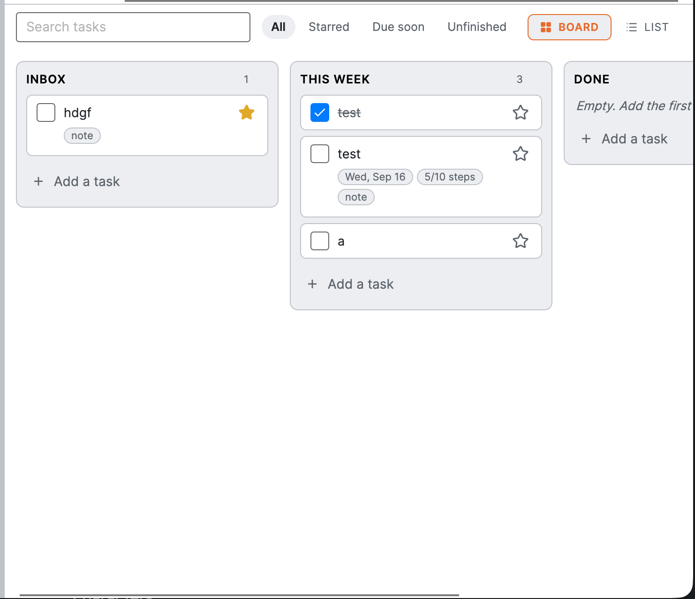
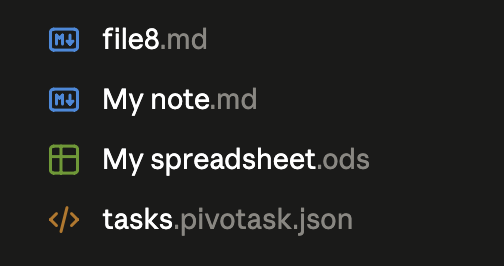

- [x] Puffinote: UI bug where clicking a tab in the tab bar at the top double highlights content in the sidebar. The sidebar should always simply match the highlight of the single file that corresponds to the active tab on the top, if there is a tab open.
- [x] Cellestra: active tab should have a colored underline underneath it in addition to the bold
- [x] Cellestra: auto resize columns to fit contents while in a table
- [x] Cellestra: header column format should also copy when adding new line after
- [x] Cellestra: editing text in a column that has word wrapped should word wrap as well (textbox should contain the contents and the cursor behavior should be expected)
- [x] Cellestra: double clicking the title bar to expand the column should widen it to the widest non-word-wrapped column, instead of all column lengths
- [x] Cellestra: while editing a value with white text in the light theme (table header) the text remains white, it should be black so you can see it against the background
- [x] Cellestra: pre-fill previous commands done in the current session at the top of the command bar so you can quickly do them again
- [x] Cellestra: change "?" keyboard shortcut to cmd+? since I do actually type "?" into cells from the main navigation view
- [x] Cellestra: if text is autocompleted while entering, if I use a different case than the autocomplete does it should stop autocompleting and type the correct capitalization on the letter
- [x] Cellestra: saving the document should append "- Saved" to the top title bar for a brief period
- [x] Cellestra: shift+return to enter newline in editing textbox
- [x] Cellestra: when editing cell, keep the current behavior of the cell remaining on screen, but ensure it continues being edited without the odd delay it has currently for new characters
- [x] Cellestra: when scrolling and a table's contents are on screen, visually show table's column titles in the top column headers (and remember to also do the opposite, if scrolling past the table end it should revert back to not include the titles at the top headers)
- [x] Typage: bug fix for unexpected behavior that adds extra newlines unexpectedly
- [x] Plaintain: Create a new plaintext editor (use the plan file)
- [x] Pivotask: Create a new todos editor (use the plan file)

- [x] Across all apps, add a settings menu to be able to configure the options present in the configuration file.
    - [x] Cellestra
    - [x] Puffinote
    - [x] Typage
    - [x] Plaintain
    - [x] Pivotask

- [x] Across all apps, Center-align the document name in the title bar
    - [x] Cellestra
    - [x] Puffinote
    - [x] Typage
    - [x] Plaintain
    - [x] Pivotask

    One shared control, `shared/Puffinote.Components/Shell/DocumentTitleBar.cs`. There was nothing to
    align before this: every app left its title to the native title bar, which macOS centres and the
    other platforms left-align, and which showed whatever `Window.Title` said — suffixes and all. The
    bar is the app's own, so it can show the document's name alone, centred, with the "edited" dot and
    Cellestra's transient "Saved" badge. `DocumentTitleBar.Extend` merges it with the window on macOS
    (extending the client area keeps the traffic lights and drops only the system's title text), which
    is Cellestra PRD §6.1's "unified with the window". `Window.Title` is unchanged — it is what the
    Window menu and app switcher show. **Not verified on a real Mac**: the container is headless, so
    the extended-client-area path (traffic-light inset, drag, double-click zoom) is reasoned about, not
    seen. Windows and Linux keep their native title bar with this one below it; taking those over means
    owning the caption buttons too, which is its own piece of work.

- [x] Across all apps, the custom title bar should carry the OS title bar's click behaviours — double-click
  to maximise, double-click again to return to the previous size and position, click and drag to move the
  window.
    - [x] Cellestra
    - [x] Puffinote
    - [x] Typage
    - [x] Plaintain
    - [x] Pivotask

    All five mount the one `DocumentTitleBar`, so this is one control's job. It already had a drag/zoom
    handler and **none of it ever ran**: the handler asked for `VisualRoot as Window`, and as of Avalonia 12
    a window's visual root is the host that draws its frame, with the `Window` beneath it — so the cast
    yielded null on every press and the bar silently did nothing. `TopLevel.GetTopLevel` is the supported
    way to ask. On top of that fix: the move is now armed on the press and only begun once the pointer
    travels 4px, because every platform's window move is a modal loop that owns the mouse until the button
    comes up — starting it on the press would have swallowed the second click of every double-click. A
    window that can't be resized doesn't zoom (its zoom button is disabled everywhere), full screen is left
    to the window manager, and a maximised window being dragged is left alone too: restoring it under the
    cursor, snapping to screen edges and honouring modifiers are all the window manager's own gestures, and
    it performs them for free once `BeginMoveDrag` hands over. Covered by `DocumentTitleBarGestureTests`.
    **Still not verified on a real Mac** for the same reason as the item above — the container is headless.
    Not done: right-click for the system window menu (Avalonia exposes no API for it), and macOS's
    "double-click a window's title bar to Minimize" preference, which we can't read without new interop —
    both would be worth a look on a Mac.

- [x] If not present, implement zooming in/out across all apps (puffinote and typage)(cmd + zooms in, cmd - zooms out)
    - [x] Cellestra
    - [x] Puffinote
    - [x] Typage
    - [x] Plaintain
    - [x] Pivotask
    - Zoom In / Zoom Out / Actual Size are defined once in `Puffinote.Components` (`ZoomCommands` over the
      shared `ZoomScale` ladder, 50%–400%) and spliced into each editor's own catalog, so all five apps carry
      one id, one title and one chord. ⌘= in, ⌘− out, **⌥⌘0** reset — reset avoids plain ⌘0 because that is
      already the last rung of Typage's heading ladder (⌘1–⌘6 apply a level, ⌘0 removes it), and one chord
      meaning two things depending on the open Puffinote tab is the thing this repo keeps saying not to do.
      Puffinote itself has no zoom code: it binds the active pane's catalog.

- [x] Plaintain: pinch-to-zoom — and with it Typage, Cellestra and Pivotask, since all four share `ZoomScale`.
    - Wired once, in `Puffinote.Components` (`PinchZoom`, over the `PinchZoomGesture` accumulator), against
      the same read/write pair each editor already hands `ZoomCommands`. Each view attaches it in one line.
    - The gesture is watched in both places it can be observed. macOS reports a trackpad pinch as its own
      gesture (`PointerTouchPadGestureMagnify`, carrying an NSEvent magnification); Windows and X11 have no
      such event and their drivers report it as **ctrl+wheel** — which is also what a mouse user presses to
      zoom, so the two arrive as one case. The wheel route has to tunnel: the surfaces underneath (Plaintain's
      editor, Cellestra's grid) handle the wheel themselves and mark it handled, so a bubbling handler would
      scroll the document instead of zooming it.
    - A pinch lands on the same stops as ⌘= / ⌘−, rather than zooming continuously. One ladder for the family
      is the point: a reader who pinches to "137%" and then presses ⌘= has to be told what the next size even
      is, and every intermediate value would re-lay out a whole sheet on the way past. About 0.15 of
      magnification (or one wheel notch) buys a stop, so a full-hand pinch covers roughly 100% → 300%; the
      residue is dropped after 250ms of quiet, so one pinch can never finish the one before it.
    - Not done: a touchscreen two-finger pinch (Avalonia's `PinchGestureRecognizer`). Same word, different
      device — and adding that recognizer changes how touch scrolling competes on all four surfaces, which is
      a decision for whenever a touch device is actually a target.

- [x] Cellestra: editing text in a column that has word wrapped should word wrap the popup text editor as well (the textbox popup should contain similar contents and the cursor behavior should be expected)
- [x] Cellestra: If text is autocompleted while entering, It should also not autocomplete the title of a table, only the distinct value of one of its preceding rows in that column.

- [x] Cellestra: shift+return to enter newline in editing textbox has unexpected UI behavior in the top formula textbox, it should only extend the height of the specific textbox editor my cursor is in. There are two textbox editors, one inline, and one in the formula bar. 

- [x] Cellestra IN Puffinote: 

    Not a second editor — the *inline* one, drawn where it doesn't belong. Typing in the formula bar
    opens a mirrored, focus-less edit on the active cell, and that cell is often off screen (one tall
    wrapped row above it is enough; a Puffinote tab is shorter than the standalone window, so it happens
    sooner there). With no cell to sit on, `ArrangeOverride` "hid" the editor by arranging it at
    `(0,0,0,0)` — which hides nothing: the theme floors a TextBox at 64×32 and Avalonia centres a control
    it couldn't shrink inside the rect it was handed, so the editor reappeared as a stray box over the
    grid's top-left corner. It is now parked far off the grid instead, and the editor's own minimums are
    zeroed so an arranged rect is honoured exactly. That second half fixed a quieter bug of the same
    cause: on a default 20px row the editor was drawn 6px *above* its own cell, so the text you were
    typing sat above the text you were about to commit. Parked rather than `IsVisible = false` on
    purpose — hiding blurs the editor and the blur handler commits, which would make scrolling silently
    write the cell.

- [x] Puffinote: Add a "Close Other Tabs" command to the tab bar context menu, which closes all tabs except the one that was right-clicked. This is a common feature in tabbed interfaces and would improve usability. (Add a command to the command bar for this as well)
- [x] Puffinote: When opening a note in the left sidebar, the tab in the top bar should scroll into view if it is not currently visible. This ensures that the user can always see which tab is active and improves navigation within the application.

- [ ] Puffinote: The "Collapse All Folders" button should change to "Expand All Folders" when the file tree is fully collapsed, and vice versa. This provides clear feedback to the user about the current state of the file tree and what action the button will perform. Ensure that the top of the file tree stays in place, and does not repeat a current UI bug where each time the button is clicked it increases a small visual gap downwards by one or a few pixels each time. This is a visual bug that should be fixed to maintain a consistent and stable UI.

- [ ] Puffinote: The "New Note" button should just be a "New" button with a normal "Plus" icon, and when clicked, show a context menu with options for "New Folder", "New Note", "New Spreadsheet", "New Taskboard", and "New File". New File should permit the user to use any file extension (other than the ones reserved for other pre-defined document types). This change would streamline the UI and provide users with quick access to different types of new documents.

- [ ] Puffinote: Use icon buttons for the top bar's "Files", "Outline", "Search", and "Recent" buttons. Add an icon button next to them for "Settings".
- [ ] Puffinote: The "Settings" menu should show a list of tabs for settings for each of the apps from their corresponding configuration directories. The tabs shouldn't be named with their app names, it should be named with the app's purpose, for example "General" for Puffinote's settings, "Notes" for Typage, "Spreadsheets" for Cellestra, "Tasks" for Pivotask. Each tab should show the settings for that app, and allow the user to change them. The settings should be saved to the corresponding configuration file for that app. In each UI, provide a clickable button to open the configuration file in the default text editor for that file type, so that users can edit the configuration file directly if they wish. This allows for advanced users to make changes that may not be exposed in the UI.

- [ ] Puffinote: Change the "Show Only" feature such that it is "Enter Folder" instead. Instead of showing a list of pills corresponding to pinned folders, it should not show the pills but instead it should show an option "Enter Folder" in the right click context menu of a folder in the sidebar. When clicked, it should, similar to how it does now, make the sidebar only show the contents within that folder. At the top, above the files, a new label showing the folder name like "In Folder: <FolderName>" followed by a back arrow icon button pinned to the right of that row that when clicked changes the sidebar UI back to the previous view of everything.

- [x] Puffinote: For files with the `.pivotask.json` combined file extension, use lucide's square-check icon. This makes it visually different from the regular JSON icon and helps users quickly identify Pivotask files in the file tree.
- [ ] Puffinote: Add an option to set whether the tab bar is visible or hidden in the settings menu. This allows users to customize their workspace according to their preferences, either by keeping the tab bar visible for easy navigation or hiding it for a cleaner interface. Also provide the same command in the command bar for quick access to toggle the tab bar visibility temporarily during the current session.
- [ ] Puffinote: The text on the sidebar should be brighter and more readable. The current text color is too dim, making it difficult to read, especially in low-light conditions. Adjust the text color to a brighter shade that improves readability while maintaining the overall aesthetic of the application.
- [ ] Puffinote: Instead of the pill with the file extension pinned to the right,  show the file extension after the first part in muted text color. The combined file extension for `.pivotask.json` should be muted.
- [ ] Puffinote: Add an option to set whether the muted file extension in the file tree is visible or hidden by default in the settings menu. This allows users to customize their workspace according to their preferences, either by keeping the tab bar visible for easy navigation or hiding it for a cleaner interface. Also provide the same command in the command bar for quick access to toggle the visibility temporarily during the current session.

- [ ] Puffinote: Add a "Filter" button, which when clicked, shows a text box that allows the user to filter the files in the file tree by name. The filter should be applied in real-time as the user types, and should be case-insensitive. This provides a quick and easy way for users to find specific files in large projects.

- [ ] Cellestra: When clicking the Zoom percentage bar, it should show a menu with a slider that allows selecting the available zoom level to its existing snap points. The user should be able to select a zoom level from this menu, and the application should immediately apply the selected zoom level to the content. This provides a quick and intuitive way for users to adjust the zoom level without needing to use keyboard shortcuts or menu commands.

- [ ] Cellestra: When selecting a range, the cell indicator next to the formula bar should show the range of the selected cells, e.g., "A1:B2". This provides clear feedback to the user about which cells are currently selected and allows for easier reference when working with formulas or data. This should happen both when selecting a range with the mouse and when using keyboard shortcuts to select a range, and when typing directly in the textbox.

- [ ] Pivotask: The UI significantly drifts from the prototype. Launch the prototype and compare its UI to the current implementation. The prototype is a reference for the intended design, and the current implementation should be updated to match it.

- [x] Plaintain: The cursor is slightly offset from the text in the editor.

    The surface was not drawing in a monospace font at all. `FontFamily`/`FontSize` were adopted from
    `TextBlock` via `AddOwner`, and `TextElement`'s text properties **inherit** — so the ambient UI font
    of whatever hosted the editor (the themed window, or a Puffinote tab) beat the monospace default
    underneath it, and nothing ever sets a family explicitly. The surface then measured one advance from
    `"0"` and stepped every column by it while the renderer laid out proportional glyphs, so the error
    accumulated along the row: measured against Inter at 14pt, a 16-character line drew 130.3px wide
    where the column arithmetic placed the caret at 140.0px — a caret sitting more than a full character
    past the text by the end of a short line, and further out on a longer one. The caret was only the
    visible symptom; selection, the find highlights, click-to-position and the wrap column were all
    reading the same wrong width. Both properties are now the editor's own non-inherited registrations,
    so a host can still set a font deliberately but can no longer leak one in. `CaretGeometryTests`
    covers the inheritance and the invariant the caret is placed by — that `n` columns of text occupy
    exactly `n * CharWidth`.
- [ ] Plaintain: ⌥⌘W (Word Wrap) collides with Puffinote's ⌥⌘W (Close All Tabs) — inside a Plaintain tab one of them wins and the other silently doesn't. Move one; the shell's is the older claim.
- [ ] Pivotask: the board has no way to rename a group, delete a group, delete a task, fold completed tasks, or create a label. `BoardCommands` has all five, tested, with no caller outside the tests — the commands are done and the affordances aren't.
- [ ] Puffinote: an external edit (a `git pull`, an edit in another app) refreshes the file tree and the search index but never reloads an open tab, so the pane keeps showing stale content and can overwrite the change on save. Proposal 0004 Phase 4 asks for this and it applies to every pane type, not just boards.
- [ ] Pivotask: verify the `.pivotask.json` compound-extension claim on a real Mac. The plist ships the exported `com.pivotask.board` UTI; if Launch Services won't honour a two-part extension tag, proposal 0004 §10.3 says strip the document-type claim entirely rather than fall back to claiming bare `json`.
- [ ] Pivotask: drag-and-drop is the simple press-and-release version. Phase 5's refinement is still open — a drop indicator, precise placement between cards, and a way to cancel a drag in flight.
- [ ] Pivotask: no keyboard path around the board — move between cards and columns, and move a task, without the mouse. The Move command exists; nothing binds it to a chord.
- [ ] Plaintain: measure the 50 MB load path before optimising it (proposal 0003 §9.5). The geometry was written against that number but never tested against it, and there is no benchmarks project in the area.
- [ ] Plaintain: converting a file's encoding on save is not implemented — only confirming the guessed one. An explicit "save this as UTF-8" is what actually rescues a Latin-1 file, and it must stay an explicit action, never implicit.
- [ ] Plaintain: detect mixed line endings and offer to normalise them. Offer, not force — a file with both is usually a merge artefact, but sometimes it is deliberate.
- [ ] Plaintain: no crash-recovery snapshot and no external-change detection, both of which Typage has (its PRD §7.1). A plaintext editor holding an unsaved 50 MB log is exactly where losing the buffer hurts most.
- [ ] Shared: the rule-of-three check both proposals defer to Phase 5, now that the duplication is real and observable — Plaintain's `FindBar` against Typage's, and Pivotask's label chip and relative-date pill against anything similar. Promote to `Puffinote.Components` only where the duplication genuinely is.
- [ ] Puffinote: `docs/puffinote/ARCHITECTURE.md` §13's folder tree still lists the pane files as they were two panes ago (it names an `IOutline.cs` and an `IEditorPaneFactory.cs` that don't exist). Refresh it now that `PlainTextPane` and `TaskBoardPane` are there.
- [ ] Puffinote: zoom is per-pane and per-session. The shell binds each editor's own zoom commands, so ⌘= works in every tab, but nothing persists the factor — every tab reopens at 100%, while the four standalone apps each remember theirs. Decide whether the shell should carry it in `SessionStore` (per tab, restored with the tab) or in `PuffinoteSettings` (one override for the window); the two answers behave differently for a notebook of mixed file types.
- [ ] Puffinote: decide whether the shell's title bar should flash "— Saved" the way Cellestra's now does. The editor raises a `Saved` event the shell could subscribe to; whether a notebook tab wants that acknowledgement is a design call, not an oversight.
