# Architecture

Puffinote is one TypeScript code base with three hosts and a CLI. The browser, the NAS server's client and the Electron app run the same UI. The only thing that differs between them is where the notebook's files come from.

```
     ┌──────────────────── packages/ui (Preact + signals) ─────────────────────┐
     │  Shell · Rail/Library layouts · FileTree · TabStrip · ⌘K / ⌘O · dialogs  │
     │  ShellModel (commands, overlays) · Notebook (tree, tabs, session)        │
     │  MarkdownEditor (DOM lines, hidden textarea, caret overlay)              │
     │  NotebookStore ─┬─ BrowserStore  (the browser's private folder)         │
     │                 ├─ NasStore      (fetch /api, ETag)                      │
     │                 ├─ NativeStore   (window.puffinoteNative IPC)            │
     │                 └─ MemoryStore   (demo, tests)                           │
     └───────────────────────────────────┬──────────────────────────────────────┘
                                         │ imports
     ┌──────────── packages/markdown (pure TS) ────────────┐
     │  line + inline tokenizers · MarkdownModel            │
     │  editing helpers · HTML renderer · outline           │◄──── apps/cli
     └──────────────────────────┬───────────────────────────┘
                                │
     ┌──────────── packages/text (pure TS) ────────────────┐
     │  TextDocument · selections · graphemes · codec       │
     │  DocumentBuffer · EditHistory (undo) · search · stats│
     └──────────────────────────────────────────────────────┘

 packages/node-files  Node only: atomic saves, per-file locks, listings and moves for desktop, server and CLI
 apps/web      Vite entry; one static build with relative URLs (base './') for every host
 apps/server   node:http: the static client + /api/{info,roots,list,file,mkdir,move}
 apps/desktop  Electron main + sandboxed preload; loads the apps/web build via app://puffinote/
 apps/cli      `puffinote`: reads notebooks and notes with the same engine; runs from source
```

## Layering

- `@puffinote/text` knows text, not Markdown. `@puffinote/markdown` knows Markdown, not styling. Both use no DOM or Node APIs and import no UI library. ESLint enforces this, so they run in a browser, a worker and Node.
- `@puffinote/ui` owns everything visual: styling, concealment, the shell and the stores.
- The apps are thin. They pick a store, put the shell on the page, and wire the host's native parts.
- Each package's `src/index.ts` names what it exports, and its `package.json` `exports` field allows only that file, so other packages and apps can't import a package's inner files. Export a new name there when another package needs it. The ui package's inner indexes (`commands/index.ts`, `platform/index.ts`) name their exports too, with no `export *`. A package's own tests may import its inner files.

## Text (`packages/text`)

- **`TextDocument`** is the immutable document: the text plus a line index. Offsets are UTF-16 code units. Line and column conversions are O(log n).
- **`DocumentBuffer`** applies `TextEdit`s and keeps the current document. **`EditHistory`** groups edits into undo steps: typing runs coalesce, and commands are single steps.
- **Selections** are anchor and caret offsets. Caret motion goes by grapheme cluster (`Intl.Segmenter`).
- **`readText`** decodes bytes: a BOM wins, then strict UTF-8, then a guessed encoding that the caller must treat as read-only. Line endings are kept as found.
- **`computeStats`** gives words, characters, lines and reading minutes. **`search`** finds text for the find bar. **`wordSearch`** folds text (case, accents), parses Search's queries and keeps `WordIndex`, the words of every note, for the Search panel.

## Markdown (`packages/markdown`)

- **Tokens.** A token is `{ type, start, length, role, meta, node }`. The role is `content` or `marker`. The editor hides markers in the live preview; the engine doesn't know that. `meta` carries a heading level or a task state. `node` groups the tokens of one inline construct, so the editor can reveal it as a unit.
- **Line tokenizer.** It classifies one line from the block state it enters with, and returns the tokens and the state it leaves. Block state covers fences, indented code, quotes, lists, tables and front matter.
- **Inline tokenizer.** It runs within one line, with delimiter runs for emphasis. It is tolerant: an unclosed marker is literal text.
- **`MarkdownModel`** holds the tokens and the entering state of every line. After an edit it re-tokenizes from the first changed line until the state converges with the old run. It keeps each line's tokens with offsets from the line's start, so the lines below an edit carry over untouched: `lineTokensRelative` hands out those arrays (the editor draws from them), and `lineTokens` gives document offsets.
- **`blocksOf(model)`** lists the multi-line blocks (front matter, fenced code, tables) from the model's tokens, and `updateBlocks` carries them across an edit. The editor conceals and reveals each as one unit, and the HTML renderer takes front matter, fenced code and tables to the same ends. One rule in `tableRows.ts` says which lines can be table rows, for the model and the block list alike.
- **Editing helpers** are pure functions from a document and selection to an edit: line prefixes (lists, quotes, headings, tasks) and ordered-list renumbering. Line prefixes read list markers and task boxes through the tokenizer's own scanner (`listMarker.ts`), so what Enter continues is what is styled as a list.
- **`renderHtmlDocument` / `renderHtmlBody`** walk the same tokens to self-contained HTML. Task boxes are inline SVG that matches the editor's.
- **`outlineOf`** lists the headings for the Outline panel and the CLI.

## UI (`packages/ui`)

- **Editor (`editor/`).**
  - `EditorState` holds the buffer, history, selection, view mode and a version signal for one note.
  - The editing keys decide on `EditorState` (`deleteBackward`, `deleteForward`, `enter`, `indent`), so they are tested without a DOM. The component passes in only what the layout knows, such as where ⌘⌫ stops on a wrapped row.
  - `motion.ts` holds the caret's moves. `caretMotion` decides ← and → by character, word, row and line, and reads the drawn note through a `CaretLayout` port (row edges, concealed markers, caret stops), which the editor answers from the DOM and tests answer from a model.
  - `MarkdownEditor` renders each line as DOM from its tokens (`lineRender.ts`), with concealed markers collapsed and decorations (bullets, checkboxes, quote bars, pictures) drawn in their place. `buildRows` (`rows.ts`) decides the rows first: one per line, or one widget for a table the selection doesn't touch, each with its block and list depth.
  - A hidden `<textarea>` at the caret takes keyboard, IME and clipboard input.
  - `geometry.ts` maps offsets to positions and back, from the DOM the surface rendered. Clicks, arrows, selection painting and the caret all go through it.
  - `reveal.ts` decides, per line, which markers show for the current selection.
  - `commands.ts` holds the editing behaviour (Enter, Tab, pairing, line moves), and `editorCommands.ts` turns it into catalog commands.
- **Commands (`commands/`).** `CommandCatalog` is the one list of commands. The command menu, the shortcuts, the context menus and the Electron menu bar all read it. Shortcuts are written once (`mod+shift+k`) and formatted per platform. Every run goes through `CommandCatalog.run(id, target?)`: a context menu passes the file, folder, tab or picture it was opened on as the `CommandTarget`, and the shell's `gate` refuses every command while a question waits on the user.
- **Notebook (`notebook/`).** `Notebook` is one open notebook as signals: the tree, the tabs, the active tab, the recent files, the settings and the notices. Every file change goes through it, so the tree, the tabs and the recent list stay reconciled with the folder. It also writes `.puffinote/session.json`. `Tab` (`tab.ts`) is one open note or picture. Its disk state (version, saved text) changes only through its own methods, which move its `generation` with it, so a refresh that read the disk before a save can tell its answer is stale. `search.ts` (`nb.textSearch`) runs Search and the Library's Filter over an index of every note's text, read again only when a note's size or time changes and saved in `.puffinote/cache/`. Open tabs' unsaved text takes the place of what was read. `transfer.ts` (`nb.transfer`) holds the archive download, the file import and the HTML and PDF export. `notebookSettings.ts` (`nb.config`) holds the user's preferences, the notebook's overrides in `.puffinote/settings.json` and the settings they resolve to. `storeWrites.ts` has the write that refuses to go over a file changed since it was read, for stores that give no versions. `trash.ts` keeps the notebook's own Trash in `.puffinote/trash/` for the stores without a system Trash (browser, NAS), using only the store's move. `notebookTrash.ts` (`nb.trash`) decides which Trash a delete goes to, and lists, restores and empties the notebook's own. `notebookPictures.ts` (`nb.pictures`) reads pictures for the editor, saves pasted ones, finds the ones no note shows and offers to delete them.
- **Saving a note (`notebook/saveChart.ts`).** The moves a tab may make between saved, dirty, saving, failed, conflict and closed are written once as a table of rows: from a state, on an event, to a state, with what to do on the way. `Notebook` keeps the state in each tab's signals and its own bookkeeping (the write in flight, the autosave timer, the recovery copy). A random-operation test drives the table and checks it never writes twice at once or over a conflict, keeps a recovery copy of every unsaved edit and autosaves each one; another drives the real `Notebook` against a slow, failing disk. `just diagram` redraws the table below.

```mermaid
stateDiagram-v2
  [*] --> clean
  closed --> [*]
  clean --> dirty : edit / startTimer, keepCopy
  clean --> clean : outsideChange / takeFile
  clean --> missing : outsideDelete / flag
  clean --> closed : close
  dirty --> dirty : edit / startTimer, keepCopy
  dirty --> clean : editBack / stopTimer, dropCopy
  dirty --> saving : timer / writeFile
  dirty --> saving : save / stopTimer, writeFile
  dirty --> conflict : outsideChange / stopTimer, flag
  dirty --> conflict : outsideDelete / stopTimer, flag
  dirty --> closed : close / stopTimer, discard, dropCopy
  saving --> savingDirty : edit / startTimer, keepCopy
  saving --> clean : saved / dropCopy
  saving --> failed : failed / report
  saving --> conflict : versionChanged / flag
  saving --> closed : close / discard, dropCopy
  savingDirty --> savingDirty : edit / startTimer, keepCopy
  savingDirty --> savingDirty : timer / queueSave
  savingDirty --> savingDirty : save / queueSave
  savingDirty --> dirty : saved / startTimer, runQueued
  savingDirty --> dirty : failed / report, startTimer, runQueued
  savingDirty --> conflict : versionChanged / stopTimer, flag
  savingDirty --> closed : close / stopTimer, discard, dropCopy
  failed --> dirty : edit / startTimer, keepCopy
  failed --> clean : editBack / dropCopy
  failed --> saving : save / writeFile
  failed --> conflict : outsideChange / flag
  failed --> conflict : outsideDelete / flag
  failed --> closed : close / discard, dropCopy
  conflict --> conflict : edit / keepCopy
  conflict --> dirty : fileBack / unflag, startTimer
  conflict --> clean : reloadFromDisk / replaceWithFile, unflag, dropCopy
  conflict --> saving : keepMine / overwriteFile
  conflict --> closed : close / discard, dropCopy
  missing --> conflict : edit / keepCopy
  missing --> clean : outsideChange / takeFile, unflag
  missing --> clean : fileBack / unflag
  missing --> restoring : keepMine / overwriteFile
  missing --> closed : close
  restoring --> savingDirty : edit / startTimer, keepCopy
  restoring --> clean : saved
  restoring --> missing : failed / report, flag
  restoring --> missing : versionChanged / flag
  restoring --> closed : close
```



- **Shell (`shell/`).** `ShellModel` holds the overlays (dialogs, ⌘K, ⌘O) and the shell commands. `NotebookSession` (`notebookSession.ts`, `model.session`) holds the open notebook and the switch to another: it closes the old one, resets the view state that belongs to one notebook, and drops an open that a later one overtook. `LayoutPolicy` (`layoutPolicy.ts`) decides the layout's rules apart from drawing: which layout is up, whether the tab strip shows, and the Library layout's one note at a time. `Shell` and its components draw it.
- **Stores (`platform/`).** `NotebookStore` is the only way the UI reaches files. Paths are notebook-relative and `/`-separated. Each store has its own version token for conflict detection: the mtime, size and inode (native), an mtime (browser), an ETag (NAS) or a counter (memory). A write with a stale version fails with a `ConflictError`.

## Node files (`packages/node-files`)

The desktop app, the NAS server and the CLI handle notebook files on disk with one module, so a save behaves the same in each.

- **`writeAtomic` / `replaceFile`** save through a temp file beside the target (`.<name>.<16 hex>.tmp`, matched by `TEMP_FILE`), fsync and rename, then fsync the folder. The replacement keeps the mode and, where permitted, the owner. A read-only file is refused; a hard-linked file is written in place (`overwriteInPlace`), never emptied first. `writeAtomic` follows a symlink to the file it names; `replaceFile` writes the path as given. `replaceFileSync` is the CLI's.
- **`FileLocks`** runs one save, move or delete per file at a time. A path is keyed symlink-resolved and case-folded, so every spelling of one file shares a lock; `runAll` takes several in one order.
- **`listFolder`** lists a folder, a few dozen stats at a time. It leaves out temp files, dangling links, links the caller won't follow, and folder links that loop back up.
- **`moveEntry`** renames under both paths' locks and refuses a taken name or a folder into itself.
- Refusals are a `FileError` with a code (`not-found`, `exists`, `read-only`, `into-itself`, `not-a-file`). The server turns them into statuses, the desktop app into the bridge's markers, the CLI into messages.
- Each host keeps its own path policy: the server confines paths to a root, the desktop app to granted folders.

## Web (`apps/web`)

- `Launcher.detect()` finds out where the page runs: inside Electron (`window.puffinoteNative`), served by the NAS server (`/api/info` answers), or a plain page.
- The welcome screen offers what that host can open. Recent notebooks are kept in local storage, and browser folder handles in IndexedDB.
- The built client has a strict CSP. Pictures load from `/api/file`, from blob URLs, or from the desktop's `pnfile:` scheme.

## Server (`apps/server`)

- **Configuration** is environment only:
  - `PUFFINOTE_ROOTS=Name=/dir;Other=/dir2` names the folders that hold notebooks (required).
  - `PUFFINOTE_STATIC` is the built web client (default `../web/dist`; empty means API only).
  - `PUFFINOTE_TOKEN` requires a bearer token. Without one the server refuses to start on a non-loopback address, unless `PUFFINOTE_ALLOW_NO_TOKEN=1` says a reverse proxy in front authenticates.
  - `PUFFINOTE_HOST` and `PUFFINOTE_PORT` (plain `PORT` as a fallback) set the bind address (default `0.0.0.0:8790`).
  - `PUFFINOTE_HOSTS` lists extra Host names accepted without a token.
  - `PUFFINOTE_MAX_MB` caps an upload (default 64).
- **Paths.** Every path is confined to its root, including `..`, absolute paths, NUL bytes and symlinks that point out. A listing leaves out folder links back up the listed path (a loop).
- **Writes.**
  - Each save is atomic: a temp file beside the target, fsync, rename. The replacement keeps the file's mode and, where permitted, its owner. A read-only file (no write bit, or not writable by the server) is refused with 403 rather than renamed over. A hard-linked file is written in place, never emptied first (PRD §4); the desktop app and the CLI do the same.
  - `If-Match` gives optimistic concurrency (412 if the file changed or is gone). `If-None-Match: *` stops a new note from overwriting a file.
  - Writes to one file are serialized under a key that is symlink-resolved and case-folded, so the check and the rename cannot interleave. A save checks its path is inside the root again once it has its turn, and again after making its folders, so a folder swapped for a link out while it waited isn't written through.
- **Host check.** Without a token, a request whose `Host` is not an IP literal, `localhost`, or a name in `PUFFINOTE_HOSTS` gets 421. This blocks DNS rebinding.
- **Entry point.** `src/index.ts` exports `createServer`, `FileApi` and `parseRoots` for tests and other hosts; `main.ts` wires them from the environment.
- **Files served raw.** Pictures a note shows are served with their type. Anything else is served as bytes with a sandboxing CSP, so an opened SVG runs nothing.

## Desktop (`apps/desktop`)

- **Isolation.** The renderer runs with `sandbox`, `contextIsolation` and no Node.
- **Bridge.** The preload exposes one object, `window.puffinoteNative`. The contract is in `bridge.ts`, mirrored in `packages/ui/src/platform/nativeStore.ts` and in the inlined channel names of `preload.cts`. Keep the three in step.
- **Loading.** The UI loads from `app://puffinote/`, a privileged standard scheme backed by `out/web`. Navigation away is blocked, and links open in the system browser. Pictures load from `pnfile://local/<path>`, served only inside granted folders.
- **Grants.** The renderer may only touch folders the user handed over: the open dialog, `open-file`, argv, or an earlier open, kept in `granted-files.json` under userData. Any other folder asks first. Every IPC call must come from an `app://puffinote/` frame.
- **Files.** Saves are atomic with a conflict check on the file's mtime, size and inode (the mtime alone misses a write within the same second on a disk with coarse times), and one save per file at a time. A save checks the grant again once it has its turn and after making its folders, so a folder swapped for a link out while it waited isn't written through. The version a save records comes from the written file's own handle, before the rename. A read-only file is refused, not replaced. Deletes go to the Trash. A folder watcher reports changes, debounced, and leaves out the app's own temp files and saves.
- **PDF export.** `savePdf` asks where to save, then `pdf.ts` lays the note's exported HTML out in a hidden window (scripts off, its own in-memory session that loads only the document and `data:` pictures) and `printToPDF` writes it. The browser prints the same HTML from a hidden sandboxed frame instead (`packages/ui/src/platform/print.ts`).
- **Menu and window.** The native menu is built from the renderer's catalog. The close guard asks the renderer about unsaved tabs; if it doesn't answer within 3 s, the user may force the close. If the page crashes while the window stays open, a dialog says so and Reload loads it again (`recovery.ts`); a headless run reloads without asking.
- **Build.** Vite bundles the main process into `out/main.js`, `@puffinote/node-files` included, so the packaged app needs no `node_modules`. tsc compiles the sandboxed preload on its own (`tsconfig.build.json`).
- **`PUFFINOTE_HEADLESS=1`** renders offscreen with no window or Dock icon, for automated checks.

## CLI (`apps/cli`)

- `src/spec.ts` is a small declarative parser (commands, arguments, options, help). `src/index.ts` builds the command tree. Commands are in `src/commands/`.
- All I/O goes through `CliIo` (stdout, stderr, stdin, launch), so the tests run commands in process.
- A bare path launches the desktop app with `open -a Puffinote <folder>` (macOS only).
- `html -o` writes atomically, with the same temp-file shape the desktop watcher ignores.

## Testing

- Vitest runs every package's and app's `test/` folder in Node. The UI tests cover models and pure functions (the shell model, the notebook, rendering decisions); the drawn UI is checked headlessly in a browser.
- The editor's offset ↔ visual map and the incremental tokenizer have dedicated suites. The incremental tests compare against a full re-tokenization.
- `just check` is the gate: Prettier, ESLint, `tsc -b`, Vitest, then the build.

Setup, commands and workflows are in the [development guide](development.md).
