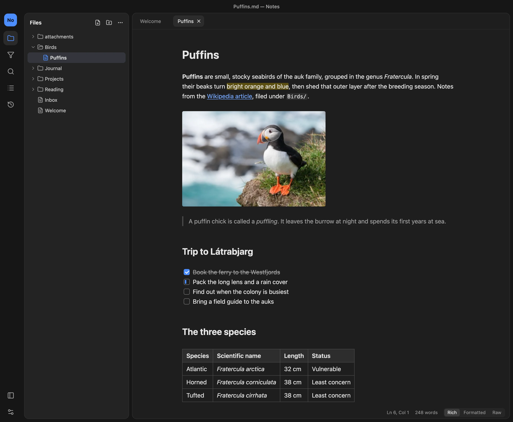

# Features

Puffinote is a notes app for a folder of Markdown files. A notebook is a folder, a note is a `.md` file, and the app keeps no database, so your notes work in any other editor, sync tool or git.

## Formatting as you type

Headings, emphasis, lists, quotes, tables and pictures show formatted. The Markdown markers stay hidden until the caret reaches them. Switch to **Formatted** to see every marker, or **Raw** for the plain source; **Rich** goes back to the live preview. The view switcher is at the right of the status bar.

## Tasks with three states

A task is `[ ]` open, `[/]` in progress or `[x]` done. A click on the box completes it, and ticked tasks move below the open ones. `⌥↑` and `⌥↓` move a list item, and `⌥⌘↑` and `⌥⌘↓` move it to the top or bottom of its list.

## Pictures in your notes

Paste or drop a picture and Puffinote saves it in the notebook and links it. Click a picture to see it full size with zoom and pan, or right-click it to rename, copy or delete it. Puffinote offers to delete pictures that no note uses any more.

## Two layouts

The **Layout** setting picks one of two layouts:

- **Icon rail:** an icon rail with a floating panel (Files, Filter, Search, Outline and Recent) and notes in tabs.
- **Library:** a library of folders beside a list of notes, one note at a time.

## Finding things

`⌘O` opens any file by name. The sidebar searches every note, filters the tree by name, and outlines the open note. `⌘K` opens the command menu, which lists every command with its shortcut, and everything works from the keyboard. See [Controls](controls.md) for every shortcut.

## Keeping up with the folder

Notes save a second after you stop typing, and every save is atomic. Changes made by other apps show up, and a note you are editing is never overwritten without asking. Closing, switching notebooks and quitting all ask first when there are unsaved changes.

## Settings per notebook

Puffinote stores each notebook's settings in a `.puffinote` folder inside the notebook, so they travel with the folder.

## Desktop, browser and NAS

The same app runs in all three. The desktop app opens any folder on disk and watches it for changes. In a browser it opens a folder through the File System Access API (Chromium browsers) or keeps notes in the browser's private storage. On a NAS, a small server shows the folders you choose to any browser on your network. See [Getting started](getting-started.md) for each one.
